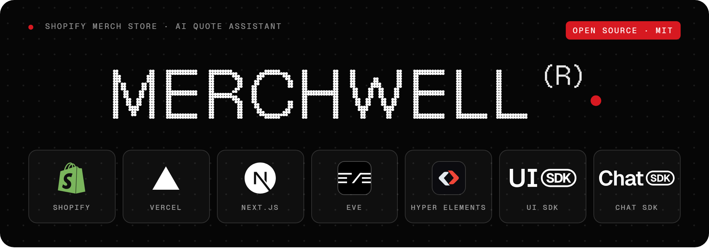
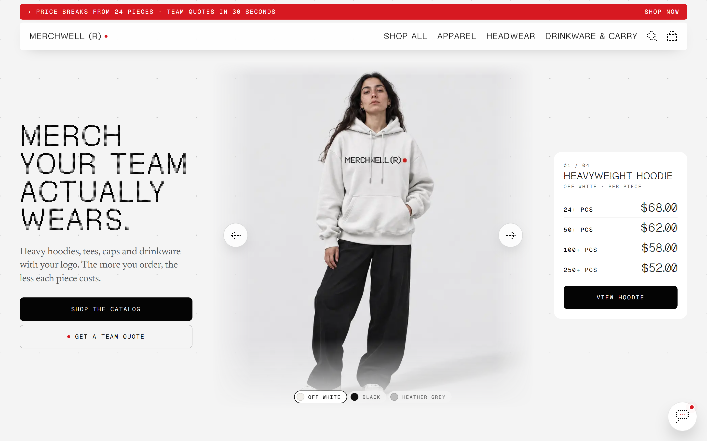
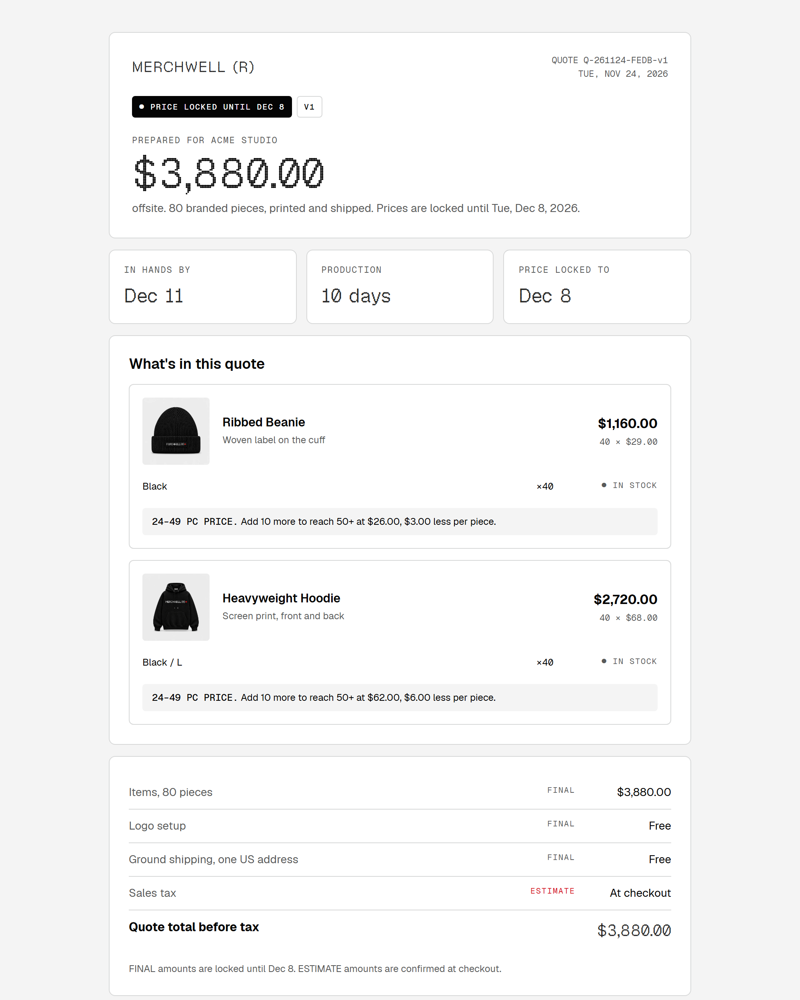
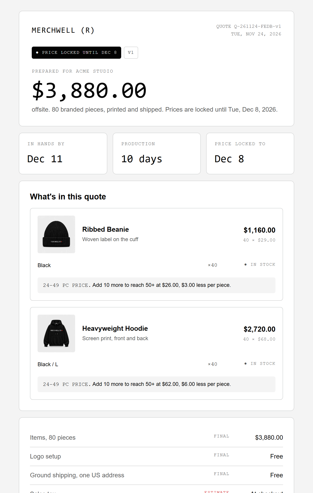
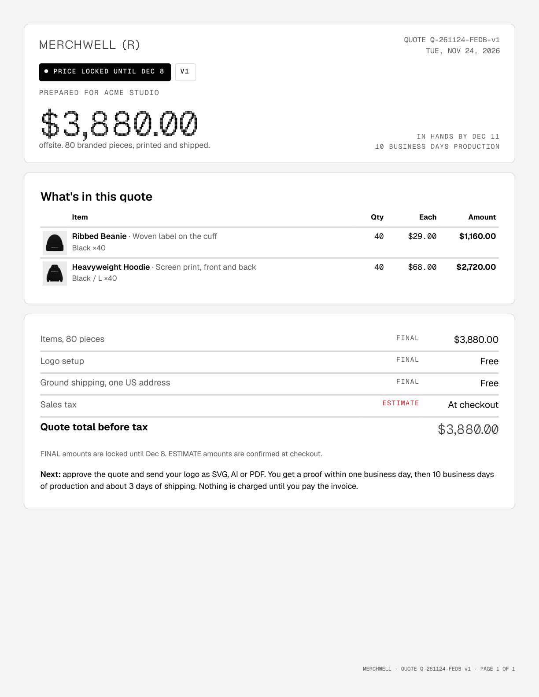
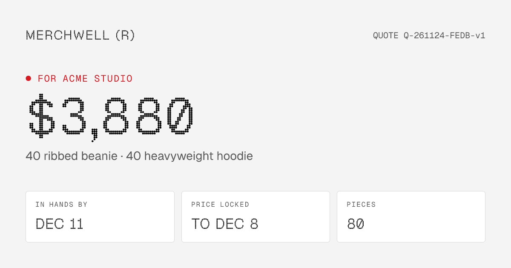
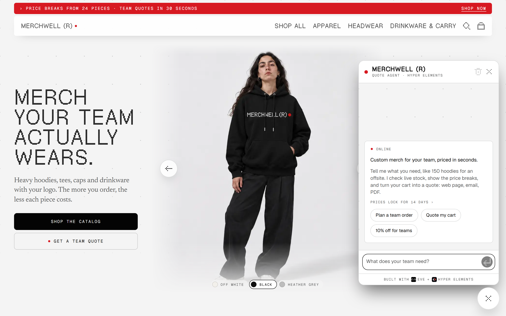
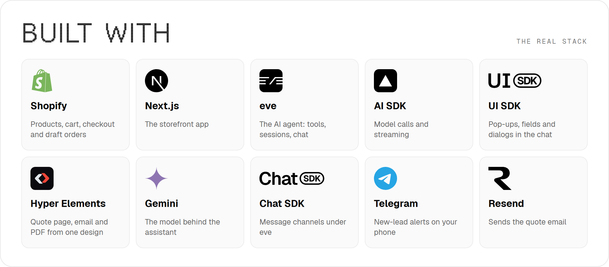
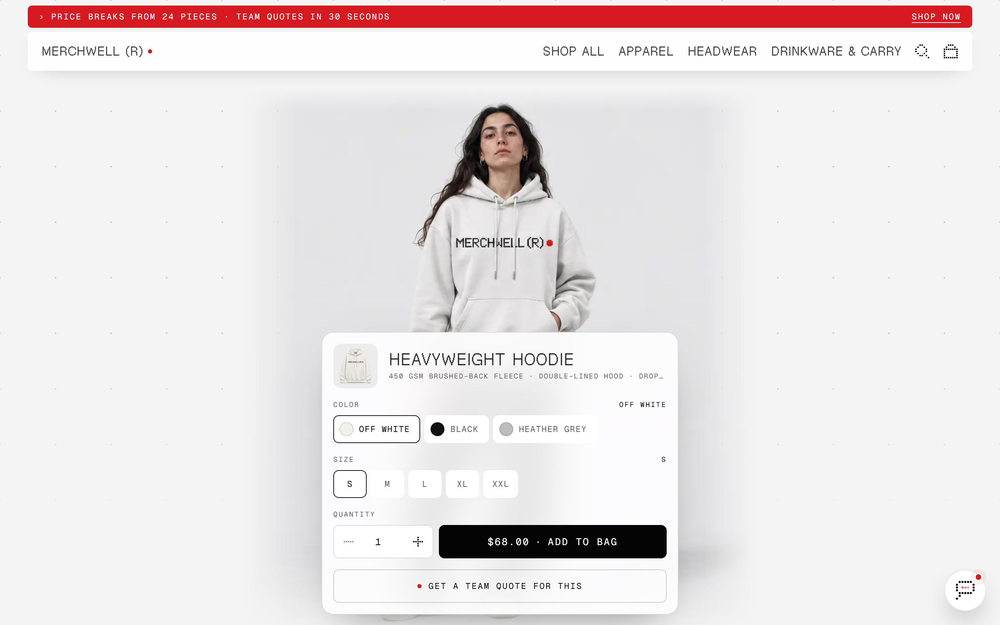
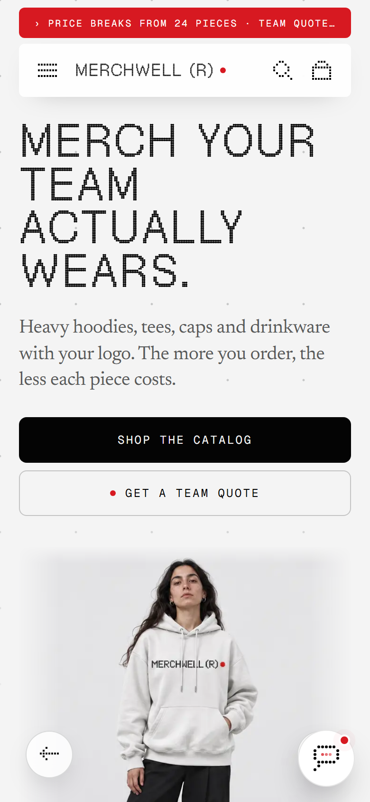

<div align="center">



<h1>Merchwell</h1>

<a href="https://github.com/hyper-elements/hyper-elements"></a>
<a href="https://github.com/vercel/eve"></a>
<a href="https://shopify.dev"></a>
<a href="https://nextjs.org"></a>
<a href="LICENSE"></a>

</div>

**Merchwell** is a Shopify merch store with an AI quote assistant built in. A buyer types what their team needs, like *"40 black hoodies and 40 beanies for our offsite"*. The assistant finds the products, fills the cart and makes a quote at team prices: a **web page, an email, a PDF and a share card**, all rendered from one [Hyper Elements](https://github.com/hyper-elements/hyper-elements) design. The quote comes with a **pay link that charges exactly the quoted total**.



## Why it exists

Ordering company merch usually means emails, spreadsheets and waiting days for a price. Merchwell turns that into one chat:

- **The buyer** gets real products, real stock and a real price in seconds, plus a quote they can forward to their boss.
- **The store owner** gets a ready-to-pay order and a ping on their phone, without writing a single quote by hand.

The AI never invents a price. Prices, stock and totals come from **Shopify**, and the quote math runs in code ([`agent/lib/pricing.ts`](agent/lib/pricing.ts)).

## One quote, four outputs

The quote is one React tree in [`agent/lib/quote-design.tsx`](agent/lib/quote-design.tsx). [`agent/lib/render-quote.tsx`](agent/lib/render-quote.tsx) hands it to Hyper Elements, which renders it four ways:

| Output | Hyper Elements call | File |
|---|---|---|
| Web page the buyer can share | `render(<QuotePage />)` | `quote.html` |
| Email (HTML + plain text) | `render(<QuoteEmail />)` | `email.html`, `email.txt` |
| One-page PDF | `renderPdf(<QuoteDocument />)` | `quote.pdf` |
| Share card for chats and socials | `renderImage(<QuoteCard />)` | `card.png` |

All four share one theme ([`agent/lib/signal-theme.ts`](agent/lib/signal-theme.ts), `defineTheme`), so a colour or font change shows up everywhere at once.

| Web page | Email | PDF |
|:-:|:-:|:-:|
|  |  |  |



## How a team order works

| Step | What happens | Powered by |
|:-:|---|---|
| **1** | The buyer asks in the chat: *"Price 50 hoodies with our logo."* | **eve** agent + **UI SDK** chat panel |
| **2** | The assistant searches the catalog and fills the cart. | **eve** tools + **Shopify** catalog |
| **3** | Prices drop at 24, 50, 100 and 250 pieces, read from each product. | **Shopify** metafields |
| **4** | The quote is made as a page, an email, a PDF and a share card. | **Hyper Elements** |
| **5** | The quote becomes a draft order with a pay link at the exact quoted total. | **Shopify** Admin API |
| **6** | When the buyer sends it, the lead is saved and the store owner gets a ping. | **Chat SDK** → Telegram (+ **Resend** email) |

The assistant always asks before it sends anything.



## Built with



- **[Hyper Elements](https://github.com/hyper-elements/hyper-elements)**: one quote design rendered as a page, an email, a PDF and an image.
- **[eve](https://github.com/vercel/eve)**: the agent framework. Every tool the assistant can use is one file in [`agent/tools/`](agent/tools).
- **[Shopify](https://shopify.dev)**: products, cart, checkout and draft orders. The only source of prices.
- **[Next.js](https://nextjs.org)** on **[Vercel](https://vercel.com)**: the storefront, started from [Vercel Shop](https://github.com/vercel/shop).
- **[UI SDK](https://ui-sdk.dev)**: the questions, fields and dialogs inside the chat.
- **[Chat SDK](https://chat-sdk.dev)**: posts new-lead alerts to the store owner's Telegram.

## Features

- **Quote assistant on every page.** Plain answers, product cards, and quick-reply chips.
- **Cart that fills itself.** The assistant adds, changes and removes items; the bag in the header updates as it works.
- **Team price breaks.** Cheaper per piece at 24, 50, 100 and 250, shown on every product page.
- **Quote in four formats.** Page, email, PDF and share card from the same design.
- **Exact pay link.** The customer pays what the quote says.
- **Lead alerts.** Every sent quote is saved and pinged to Telegram.
- **Made for phones.** Full-width menu, sticky Add to bag, and price boxes that fit small screens.

| Product page | Phone |
|:-:|:-:|
|  |  |

## Quick start

You need **Node 26** and **pnpm 12**.

```bash
git clone https://github.com/Momo410/merchwell.git
cd merchwell
pnpm install
cp .env.example .env.local   # then fill in your keys (see below)
pnpm dev
```

Open http://localhost:3000, click the chat button in the bottom right and try:

```text
Price 40 black hoodies in size L for Acme Studio
```

> [!TIP]
> No products yet? Seed the demo products and their collections into your Shopify store (safe to run again):
> ```bash
> node --env-file=.env.local node_modules/tsx/dist/cli.mjs scripts/seed-merch.ts
> node --env-file=.env.local node_modules/tsx/dist/cli.mjs scripts/seed-collections.ts
> ```

## What you need

| Service | What it's for | |
|---|---|:-:|
| **Shopify store** · a free [development store](https://shopify.dev/docs/apps/build/dev-dashboard/development-stores) works | Products, cart and checkout | **Required** |
| **Storefront API token** · Shopify admin → Settings → Apps → Headless | Lets the site read products and run the cart | **Required** |
| **Gemini API key** · [Google AI Studio](https://aistudio.google.com/apikey) | The model behind the assistant | **Required** |
| **Shopify Admin app** · client ID + secret | Price breaks, live stock, seeding and pay links | Recommended |
| **Telegram bot** · [@BotFather](https://t.me/BotFather) + your chat ID | A ping for every new quote, sent with Chat SDK | Optional |
| **Resend API key** · with a verified domain | Emails the quote to the customer | Optional |

Give the Admin app only the access you use:

| For | Permissions |
|---|---|
| The store | `read_products`, `read_inventory` |
| Pay links | `write_draft_orders` |
| Seed scripts | `write_products`, `write_inventory`, `write_publications`, `write_files` |

## Environment variables

Copy `.env.example` to `.env.local` and fill it in.

```bash
# Required
NEXT_PUBLIC_SHOPIFY_STORE_DOMAIN="your-store.myshopify.com"
NEXT_PUBLIC_SHOPIFY_STOREFRONT_ACCESS_TOKEN="your-storefront-access-token-here"
NEXT_PUBLIC_SHOPIFY_SHOP_ID="123456789"
GOOGLE_GENERATIVE_AI_API_KEY="your-gemini-api-key-here"

# Recommended: price breaks, live stock and pay links
SHOPIFY_ADMIN_CLIENT_ID="your-admin-app-client-id-here"
SHOPIFY_ADMIN_CLIENT_SECRET="your-admin-app-client-secret-here"

# Optional: lead alerts and quote emails
TELEGRAM_BOT_TOKEN="your-telegram-bot-token-here"
TELEGRAM_CHAT_ID="your-telegram-chat-id-here"
RESEND_API_KEY="your-resend-api-key-here"
QUOTE_EMAIL_FROM="Merchwell <quotes@your-domain.com>"
```

> [!CAUTION]
> Never commit `.env.local`. It's already in `.gitignore`. Every other option is explained line by line in [`.env.example`](.env.example).

## Project structure

```text
merchwell/
├── agent/                  # the AI assistant (eve)
│   ├── instructions.ts     # what it says and how it behaves
│   ├── tools/              # one file per thing it can do: search, cart, quote, send
│   └── lib/                # quote math, quote design (Hyper Elements), Shopify Admin, Telegram
├── app/                    # Next.js pages and routes
├── components/             # the UI: agent/ = chat panel, product-detail/ = product page, nav/ = menu
├── lib/                    # Shopify, cart, config and helpers
└── scripts/                # seed the demo catalog into your store
```

## Make it yours

| To change | Edit |
|---|---|
| Store name and colours | `lib/config/` and `--color-signal` in `app/globals.css` |
| What the assistant says | `agent/instructions.ts` |
| What the assistant can do | `agent/tools/` |
| The quote's look (page, email, PDF, card) | `agent/lib/quote-design.tsx` and `agent/lib/signal-theme.ts` |
| Price breaks | The `custom.price_breaks` metafield on each product in Shopify |

## Good to know

- **Quote files are written to disk** (`public/quotes/` and `.data/`). That works locally and on any Node server. On Vercel the file system is read-only, so a deployment needs the files moved to storage such as Vercel Blob.
- **Every chat message calls the AI model**, which costs money. BotID guards the agent route; also set a spending limit on your Gemini key before you share a public link.

## Troubleshooting

<details>
<summary><b>The shop is blank or has no products</b></summary>

Check the store domain and Storefront token, and make sure the products are published to your sales channel. Running `scripts/seed-merch.ts` publishes them for you.
</details>

<details>
<summary><b>The assistant doesn't answer</b></summary>

Check `GOOGLE_GENERATIVE_AI_API_KEY`, then restart `pnpm dev`.
</details>

<details>
<summary><b>The quote has no pay link</b></summary>

The pay link is a Shopify draft order, so the Admin app needs `write_draft_orders`.
</details>

<details>
<summary><b>No Telegram ping</b></summary>

Send your bot one message first, then double-check `TELEGRAM_CHAT_ID`.
</details>

## Credits

Built on [Vercel Shop](https://github.com/vercel/shop), [eve](https://github.com/vercel/eve), [Hyper Elements](https://github.com/hyper-elements/hyper-elements), [UI SDK](https://ui-sdk.dev), [Chat SDK](https://chat-sdk.dev) and the [AI SDK](https://ai-sdk.dev). Fonts: Geist (OFL). Product names and logos belong to their owners.

## License

[MIT](LICENSE)
